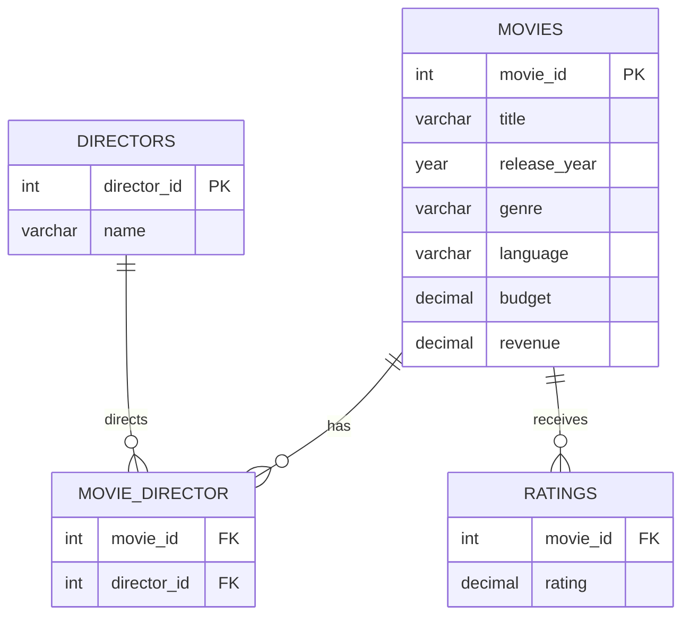

# RSVP Movies: SQL Database & Analysis


## Overview

This project designs a relational movie database in **MySQL** and uses SQL to answer business questions about revenue, profitability and audience ratings. It covers schema design with primary and foreign keys, multi-table joins, aggregation, filtering and sorting.

**Business questions answered:**

- Which movies perform best on revenue, profit and rating?
- How does budget relate to audience ratings?
- Which genres are rated highest?
- Which movies should be recommended first?

## Database Design

The `rsvp` database contains four normalized tables. A bridge table (`movie_director`) links movies to directors, so the design can support multiple directors per movie.



| Table | Description |
|---|---|
| `movies` | Title, release year, genre, language, budget and revenue |
| `directors` | Director ID and name |
| `movie_director` | Many-to-many link between movies and directors |
| `ratings` | Rating (0 to 10 scale) for each movie |

## Key Insights

Based on the sample data in this project:

| Movie | Genre | Budget | Revenue | Profit | Revenue / Budget | Rating |
|---|---|--:|--:|--:|--:|--:|
| Uri: The Surgical Strike | Action | 25.00 | 350.00 | 325.00 | 14.0x | 8.3 |
| Kedarnath | Romance | 40.00 | 100.00 | 60.00 | 2.5x | 6.9 |
| Love Per Square Foot | Comedy | 20.00 | 45.00 | 25.00 | 2.25x | 7.3 |

- **Uri: The Surgical Strike** leads on every measure: highest revenue, highest profit and highest rating (8.3). It returned 14 times its budget.
- **Kedarnath** had the largest budget but the lowest rating (6.9) and a modest return, which suggests that higher spending did not translate into better audience reception in this sample.
- **Love Per Square Foot** had the smallest budget and still earned more than double its cost, with a solid rating of 7.3.

> **Note:** The dataset contains only three movies, so these findings illustrate the analysis approach and are not statistically conclusive. Each genre also has a single movie, so the average rating per genre equals that movie's rating. The queries are written to work unchanged on larger datasets.

## Queries Implemented

| # | Business Question | SQL Concepts |
|:-:|---|---|
| 1 | Movies released after 2017 | `WHERE` |
| 2 | Highest-revenue movie | `ORDER BY`, `LIMIT` |
| 3 | Movies rated above 7 | `INNER JOIN`, `WHERE` |
| 4 | Directors and their movies | Multi-table `JOIN` |
| 5 | Profit per movie (revenue minus budget) | Calculated columns, aliases |
| 6 | Average rating per genre | `GROUP BY`, `AVG()` |
| 7 | Top 3 movies by rating (recommendations) | `JOIN`, `ORDER BY`, `LIMIT` |

### Selected Examples

**Directors and their movies** (multi-table join)

```sql
SELECT d.name AS director, m.title AS movie
FROM directors d
JOIN movie_director md ON d.director_id = md.director_id
JOIN movies m ON md.movie_id = m.movie_id;
```

| director | movie |
|---|---|
| Aditya Dhar | Uri: The Surgical Strike |
| Abhishek Kapoor | Kedarnath |
| Anand Tiwari | Love Per Square Foot |

**Profit per movie** (calculated column)

```sql
SELECT title, (revenue - budget) AS profit
FROM movies;
```

| title | profit |
|---|--:|
| Uri: The Surgical Strike | 325.00 |
| Kedarnath | 60.00 |
| Love Per Square Foot | 25.00 |

**Top 3 movies by rating** (recommendation query)

```sql
SELECT m.title, r.rating
FROM movies m
JOIN ratings r ON m.movie_id = r.movie_id
ORDER BY r.rating DESC
LIMIT 3;
```

| title | rating |
|---|--:|
| Uri: The Surgical Strike | 8.3 |
| Love Per Square Foot | 7.3 |
| Kedarnath | 6.9 |

The complete set of queries is in [`rsvp_project.sql`](rsvp_project.sql).

## Repository Contents

```
.
├── rsvp_project.sql    # Schema, sample data and all queries
└── README.md           # Project documentation
```

## How to Run

1. Install MySQL (8.0 or later recommended) and a client such as MySQL Workbench.
2. Clone the repository:
   ```bash
   git clone https://github.com/YOUR-USERNAME/rsvp-movies-sql.git
   ```
3. Open `rsvp_project.sql` in your client and execute the script. It creates the `rsvp` database, builds the tables, inserts the sample data and runs the analysis queries.

## Skills Demonstrated

- Relational database design and normalization
- Primary keys, foreign keys and bridge tables for many-to-many relationships
- Inner joins across multiple tables
- Aggregation with `GROUP BY` and `AVG()`
- Filtering, sorting and limiting results
- Derived metrics such as profit and return on budget
- Writing clear, commented SQL

## Possible Extensions

- Expand the dataset with more movies, genres and languages
- Add an `actors` table with a many-to-many relationship to movies
- Use window functions (`RANK()`, `ROW_NUMBER()`) for ranking within genres
- Connect the database to Power BI or Tableau for a dashboard

## Author

**YOUR NAME**
[LinkedIn](https://www.linkedin.com/in/YOUR-PROFILE) | [GitHub](https://github.com/YOUR-USERNAME) | your.email@example.com
